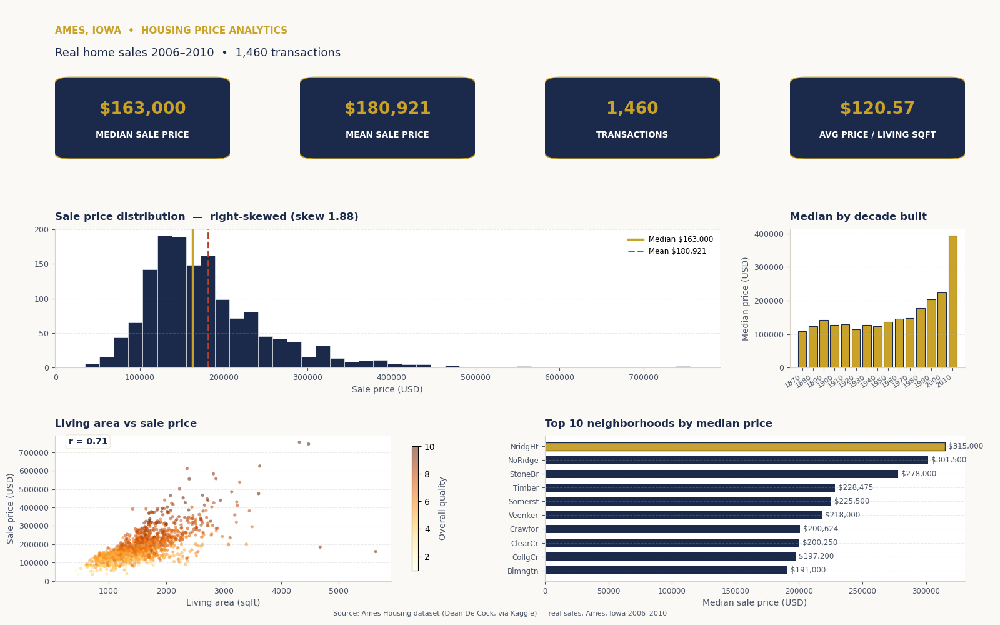

# Ames, Iowa Housing Price Analytics

> **Note:** this project folder is named `saudi-real-estate-dashboard` for legacy
> reasons (it was the working directory), but the data and the entire analysis
> below are about **residential home sales in Ames, Iowa, USA (2006–2010)** —
> not Saudi Arabia.

An end-to-end data project on a real housing dataset: a single polished
`dashboard.png` (1600×1000 px) with a KPI row and five analytical panels, all
computed from the CSV — no synthetic data.



## Dataset

- **Name:** Ames Housing dataset (`train.csv`, 1,460 rows × 81 columns)
- **What it is:** real residential home sales in Ames, Iowa, USA, sold 2006–2010,
  compiled by **Dean De Cock** for data-science education and distributed via
  the Kaggle competition **"House Prices: Advanced Regression Techniques"**.
- **Source / raw download URL:**
  `https://raw.githubusercontent.com/jzuniga123/SPS/master/DATA%20605/train.csv`
  (a mirror copy of the competition's training data; saved locally as
  `data/ames_housing.csv`).
- **Rows/columns after cleaning:** 1,460 rows × 80 columns.

## Cleaning notes

- The `Id` column (a row identifier) was dropped in `dashboard.py`; all 80
  analytical columns were kept as-is.
- No rows were removed and no values were imputed — every figure on the
  dashboard is computed directly from the CSV.
- The decade trend panel only includes decades with at least 5 homes (this
  excludes the single home built in 2010, which would otherwise distort the
  trend as a one-observation "median").

## Key insights (computed from the real data)

- **Median sale price:** $163,000; **mean:** $180,921 (right-skewed, skew = 1.88).
- **1,460 transactions** at an **average of $120.57 per living sqft**.
- **Quality drives price:** Overall Quality correlates with Sale Price at **0.79** —
  median price rises from $50,150 (quality 1) to $432,390 (quality 10).
- **Size matters too:** above-ground living area correlates with price at **0.71**.
- **Most expensive neighborhood:** Northridge Heights (NridgHt), median $315,000,
  followed by Northridge (NoRidge, $301,500).
- **Highest single sale:** $755,000 — a quality-10, 4,316 sqft home in NoRidge.
- **Newer homes cost more:** median price by decade built rises from ~$115K–$127K
  (1900s–1940s) to $223,500 for homes built in the 2000s.

## Tech stack

- Python, pandas, NumPy, matplotlib (Agg backend)

## How to run

```bash
pip install -r requirements.txt
python download_data.py   # downloads the real CSV into data/ames_housing.csv
python dashboard.py       # builds dashboard.png (1600x1000 px)
```

## Files

| File | Description |
|---|---|
| `dashboard.py` | Builds the dashboard image from the CSV |
| `download_data.py` | Downloads the real Ames Housing CSV into `data/` |
| `data/ames_housing.csv` | The real dataset (1,460 × 81) |
| `dashboard.png` | The generated 1600×1000 px dashboard (navy + gold design) |
| `powerbi-page1-overview.py` | Paste-ready Power BI Python visual — Page 1: KPIs + main trends |
| `powerbi-page2-details.py` | Paste-ready Power BI Python visual — Page 2: breakdowns & details |
| `powerbi-guide.md` | Arabic step-by-step guide to rebuild this in Power BI Desktop |
| `requirements.txt` | pandas, matplotlib, numpy |
